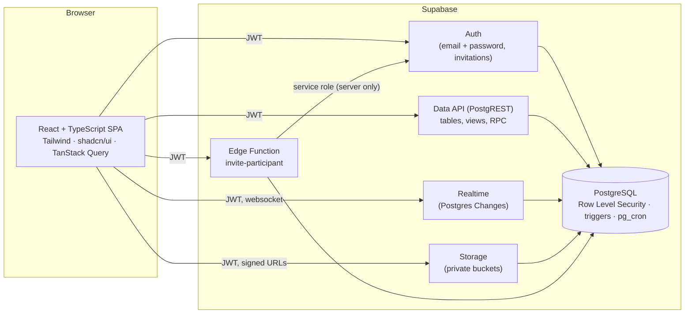
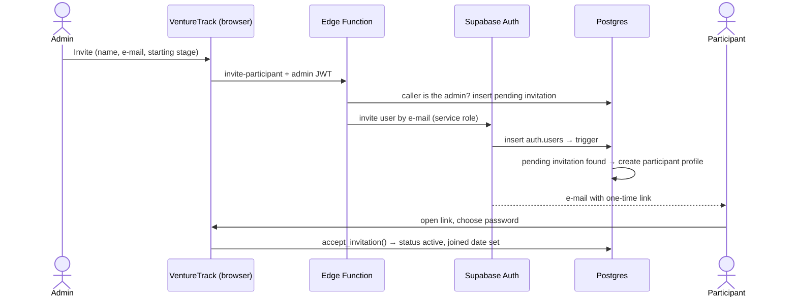
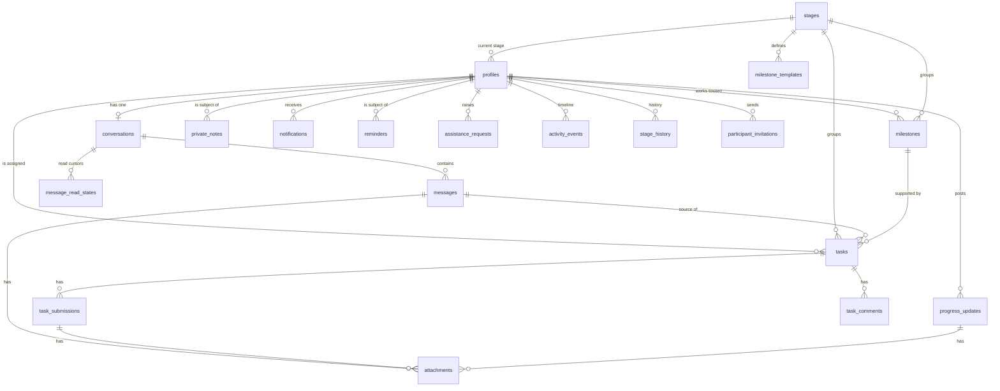

# VentureTrack — Architecture & Implementation Plan

> **Status: proposal, awaiting approval.** No application code exists yet.
> What has been done so far is design work only:
>
> - The database design in [`schema.sql`](./schema.sql) was applied to a real local
>   Supabase stack (Postgres 17) — it applies cleanly and passes `supabase db lint`.
> - 38 access-control smoke checks were run against it with simulated users
>   (anonymous, two participants, an archived participant, the admin, the service
>   role) and all behaved as designed.
> - **Not yet built or tested:** the auth flow, triggers and RPCs, storage policies
>   in practice, Realtime delivery, and the entire user interface.

VentureTrack is a platform for one administrator to manage the **individual people**
taking part in an entrepreneurship programme: invite them, talk to them privately,
assign and review tasks, and track verified progress toward starting a business.
There are no companies, teams or organisations in the data model — only people.

---

## 0. Changes requested after the sample version

The owner reviewed the click-through sample and asked for three changes. The
sample already shows them. **Sections 2–4 and `schema.sql` below still describe
the earlier design and must be revised before Phase 1 and Phase 3 start.**

| Request | What it changes in the design |
|---|---|
| Participants can message other participants | `conversations` is no longer "exactly one per participant". It becomes a conversation between any two people, with RLS by membership. Participants need to read a minimal directory of other participants (name and avatar only). Open decision: whether the administrator can read participant-to-participant conversations (the sample assumes not). |
| Pictures and files attached to handed-in work | Already covered by `attachments` on `task_submissions`; needs upload UI, size and type limits, and storage policies tested in Phase 4. |
| Sign in with a username and password | **Decided and built (Phase 1).** `profiles.username` is unique and chosen when the invitation is accepted. The `sign-in` Edge Function resolves it to the e-mail server-side, so the e-mail never reaches the browser; unknown usernames and wrong passwords give the same answer; five failures in 15 minutes lock the username. "Forgot password" goes through the same function and always gives the same answer. |

---

### Phase 1 as built

Source of truth: `supabase/migrations/`, `supabase/functions/`, `supabase/tests/`.
Differences from the proposal below:

- Two Edge Functions, not one: `sign-in` (username sign-in, forgot password) and
  `invite-participant` (invite, re-send, cancel). Neither has external imports.
- Authorization for inviting lives in the database: the function calls
  `create_invitation` / `revoke_invitation` with the caller's own token.
- Participants can read **only their own** profile row. The earlier policy let
  them read the administrator's row, which exposed the administrator's e-mail.
  A names-only directory for messaging will be added in Phase 3.
- `provision_admin(email, username)` takes the administrator's username.
- Archived and not-yet-accepted accounts are read-only (enforced in `profiles_guard`).
- Verified by `npm run test:db` (34 pgTAP assertions) and `npm run test:real`
  (31 end-to-end checks against the local stack, including direct API attacks).
- Not yet done for Phase 1: deployment to a hosted project, a real e-mail
  provider, avatar upload, admin settings screens.

### Tasks and messages as built

Source of truth: `supabase/migrations/20261114*`. Differences from the proposal below:

- **Messages** are direct messages between any two people (`messages` with a
  sender and a recipient), not one conversation per participant. Only the two
  people in a message can read it; the administrator cannot read
  participant-to-participant messages. Participants get other people's names
  through `directory()` and nothing else. Delivery is by polling every five
  seconds; Realtime is not used yet.
- **Tasks**: status changes only through `start_task`, `submit_task` and
  `review_task`. No API role has a column privilege on `status`, including
  the administrator.
- **Attachments** live in the private `submissions` bucket under
  `<participant id>/<task id>/`. There are no update or delete policies, so a
  handed-in file cannot be swapped or removed.
- **Progress** is computed in the client from approved tasks in the current
  stage. Milestones, task comments, stage history and progress updates are
  not built.

---

## 1. Application architecture



### Technology choices

| Layer | Choice | Why |
|---|---|---|
| UI | React + TypeScript, built with Vite | As requested. A single-page app is enough: every screen is behind login, so server rendering adds nothing. |
| Styling / components | Tailwind CSS + shadcn/ui (Radix primitives), lucide icons | As requested. Accessible primitives; we own the component code. |
| Routing | React Router, two guarded route trees (`/admin/*`, `/app/*`) | Clear separation of the two roles. |
| Server state | TanStack Query + `supabase-js` | Caching, loading/error states, optimistic updates; Realtime events invalidate or patch the cache. |
| Forms / validation | react-hook-form + zod | Typed, accessible forms; the same rules are re-enforced by database constraints. |
| Charts | Recharts | Progress and analytics charts. |
| Backend | Supabase: Postgres, Auth, Realtime, Storage, one Edge Function | As requested. |
| Scheduled jobs | `pg_cron` inside Postgres | Due/overdue notifications, invitation expiry, message retention. |
| Tests | pgTAP (database + RLS), Vitest + Testing Library (UI), Playwright (end-to-end) | See section 8. |

### Key architectural decisions

1. **The database is the security boundary.** The browser talks to Supabase directly,
   so nothing in the React code is trusted. Every rule that matters — who can read a
   message, who can approve a task, who is the admin — is enforced in Postgres
   (privileges, Row Level Security, constraints, triggers). The UI only *reflects*
   those rules.
2. **Vite SPA instead of Next.js.** There is no public content, no SEO need, and the
   app is real-time-heavy. A static SPA has fewer moving parts and can be hosted
   anywhere. (Switching to Next.js is possible if you prefer it; say so before Phase 1.)
3. **Server-side code only where a secret is unavoidable.** Creating an auth user for
   an invitation needs Supabase's service-role key, which must never reach a browser.
   That one operation lives in an Edge Function. Everything else is SQL.
4. **Realtime via Postgres Changes.** Supabase checks each change against the
   subscriber's RLS before delivering it, so the real-time channel cannot leak rows a
   user could not query. Adequate for one admin and hundreds of participants.
5. **Derived numbers are computed, not stored.** Progress percentages, unread counts
   and "needs attention" flags come from SQL views over the source rows, so they
   cannot drift out of sync.

### Repository layout (created in Phase 1)

```
src/
  app/            router, providers, layouts (admin / participant / auth)
  features/       auth, participants, dashboard, messages, tasks, progress,
                  followups, calendar, analytics, notifications, settings
  components/ui/  shadcn/ui components
  lib/            supabase client, query client, formatting helpers
  types/          database types generated from the schema
supabase/
  config.toml     local stack + auth configuration
  migrations/     SQL migrations (one or more per phase)
  functions/      invite-participant Edge Function
  tests/          pgTAP tests for constraints, triggers and RLS
  seed.sql        local development data
e2e/              Playwright tests
docs/             this document, setup and deployment guides
```

---

## 2. Authentication and authorization

### Identities

- Accounts live in Supabase Auth (`auth.users`): e-mail + password, with password
  reset by e-mail. Sessions are JWTs managed by `supabase-js`.
- Every account has exactly one row in `public.profiles`, created by a database
  trigger — never by the client.
- **Public sign-up is disabled.** There is no registration page.

### The single administrator

The admin role is the value `'admin'` in `profiles.role`, protected four ways:

| Guarantee | Mechanism |
|---|---|
| Only one admin can exist | Partial unique index on `profiles(role) where role = 'admin'` |
| `role` cannot be written through the API by anyone, including the admin | No column privilege on `role` for API roles |
| Not even server-side code can hand it out | `profiles_guard` trigger rejects role changes unless made by the database owner |
| It cannot be obtained by registering | Profiles are created by a trigger that always inserts `'participant'` |

**Provisioning is a one-time manual step that requires database-owner access**
(i.e. you, in the Supabase dashboard):

1. Create your own user under *Authentication → Users → Add user*.
2. Run `select private.provision_admin('you@example.com');` in the SQL editor.
   It refuses to run if an admin already exists, if the e-mail is unconfirmed, or if
   any other account exists.

No screen, API endpoint, sign-up field or profile field can assign the role.

### Invitation-only onboarding



- The trigger on `auth.users` **rejects any new account without a pending, unexpired
  invitation**, so the rule holds even if sign-up were re-enabled by mistake. The one
  exception is the very first account, created by you before an admin exists; it is
  an ordinary unprivileged account until you run `provision_admin`.
- Invitations expire after 14 days; the admin can resend or revoke them.

### Authorization layers

Both roles connect to Postgres as the same database role (`authenticated`); what
differs is the identity inside the JWT. Rules are layered:

1. **Privileges** — the anonymous role has no access to any table. Signed-in users
   get explicit, often column-level grants (e.g. a message insert may only supply
   `id`, `conversation_id`, `body` — never `sender_id` or `created_at`).
2. **Row Level Security** on every table — a participant's rows are those where
   `participant_id = auth.uid()`; the admin passes `private.is_admin()`. Child rows
   (messages, submissions, comments, attachments) are visible exactly when their
   parent is.
3. **Guards and RPCs** for rules RLS cannot express — which profile columns a
   participant may edit, which task status changes are allowed, server-stamped read
   receipts.
4. **Storage policies** — private buckets; a file path always starts with the owning
   participant's id, and only that participant and the admin can read it. Downloads
   use short-lived signed URLs.
5. **Realtime** applies the same RLS before delivering any event.
6. **UI route guards** — convenience only; never relied on for security.

### What each role can do

| Area | Participant | Administrator |
|---|---|---|
| Profiles | Read own (and the admin's name/avatar). Edit own name, avatar, business idea, goals. | Read all. Edit all, set stage, mark completed, archive. |
| Private notes | **No access of any kind** | Full |
| Conversation & messages | Own conversation only: read, send, attach | All conversations |
| Tasks | Read own; move between *Not started* / *In progress*; submit work; comment | Create, edit, delete, review, approve, request revision |
| Milestones & stage | Read own | Full; only the admin marks a milestone achieved or changes a stage |
| Progress updates | Post own, read feedback | Read all, give feedback |
| Reminders, invitations, analytics, settings | No access | Full |
| Announcements | Read published | Full |
| Notifications | Own only | Own only |
| Archived participant | Read-only access to own history | — |

---

## 3. Database schema

The complete DDL — tables, constraints, indexes, RLS policies, grants and storage
policies — is in [`schema.sql`](./schema.sql). Summary:



| Table | Purpose | Phase |
|---|---|---|
| `profiles` | One row per person: role, name, e-mail, date joined, business idea, goals, current stage, status, archive flag, last activity | 1 |
| `participant_invitations` | Who was invited, by whom, status and expiry | 1 |
| `stages` | The admin-customisable development stages (seeded with the six defaults) | 1 |
| `app_settings` | Single-row settings: programme name, inactivity threshold, message retention | 1 |
| `private_notes` | Admin-only notes about a participant | 2 |
| `activity_events` | Append-only timeline, written by triggers | 2 |
| `conversations` | Exactly one per participant (unique constraint) | 3 |
| `messages` | Message body, sender, timestamp, full-text search column | 3 |
| `message_read_states` | One read cursor per user per conversation → unread counts and read receipts | 3 |
| `attachments` | File metadata; belongs to exactly one message, submission or progress update | 3–4 |
| `notifications` | In-app notifications, delivered live | 3, 5 |
| `tasks` | Assigned work with status, priority, deadline, optional link to a stage, milestone and source message | 4 |
| `task_submissions` | Submitted work plus the admin's decision and feedback | 4 |
| `task_comments` | Discussion on a task | 4 |
| `milestone_templates` | Default milestones per stage | 4 |
| `milestones` | A participant's milestones; achieved only when admin-verified | 4 |
| `stage_history` | Every stage change, with who and when | 4 |
| `progress_updates` | Participant-written updates with supporting documents and admin feedback | 4 |
| `reminders` | The admin's follow-ups, optionally recurring, resolvable | 5 |
| `assistance_requests` | "I need help" requests from participants | 5 |
| `announcements` | Draft / published announcements | 5 |

Design notes:

- **Integrity by constraint.** Composite foreign keys guarantee, for example, that a
  task can only link to a milestone of the *same* participant and that only the
  assigned participant can be the author of a submission. Check constraints keep
  status and timestamp columns consistent (`completed` ⇔ `completed_at` is set).
- **Messages are immutable from the API** — there are no update or delete policies.
  They are kept permanently unless removed by the retention rule in settings
  (default: keep forever) or by an admin moderation action.
- **Read states are per conversation, not per message.** Conversations always have
  exactly two parties, so one cursor each gives exact unread counts and read
  receipts with a single small table.
- **Every foreign key is indexed**; hot paths have dedicated indexes (message
  pagination, open tasks by due date, unread notifications, full-text search).

### Server-side logic still to be written (not in `schema.sql`)

| Phase | Functions, triggers and jobs |
|---|---|
| 1 | `handle_new_user` trigger on `auth.users`; e-mail sync; `provision_admin()`; `accept_invitation()`; `touch_last_active()`; `invite-participant` Edge Function (invite, resend, revoke) |
| 2 | Activity-logging triggers; `participant_overview` view; dashboard statistics |
| 3 | Auto-create conversation; `send_message()` (message + attachments in one transaction); `mark_conversation_read()`; `search_messages()`; inbox view; new-message notifications |
| 4 | Task status rules and side effects; `set_my_task_status()`; submission and review flow; stage history; milestone templates; `participant_progress` view |
| 5 | Notification fan-out; `resolve_reminder()` with recurrence; scheduled jobs; analytics queries |

### How progress is calculated

Progress must reflect **verified** work and must not pretend that finishing tasks
proves business readiness. Proposal:

```
progress = (stages already passed + verified share of the current stage) / number of stages
```

- *Verified share of the current stage* = approved tasks + admin-verified milestones
  in that stage, divided by all tasks + milestones in that stage.
- **Only the admin moves a participant to the next stage.** Finishing every task in
  a stage fills that stage's segment and prompts the admin to review — it never
  advances the stage automatically.
- 100% is reached only when the admin marks the participant as having completed the
  programme.
- Self-reported states (*In progress*, *Submitted*, progress updates) never count.

The UI labels this "verified progress" and shows it as a bar segmented by stage.

---

## 4. Screens and navigation

### Administrator

| Navigation | Screens |
|---|---|
| **Dashboard** | KPI cards (total, active, needing attention, overdue tasks, unread messages, programme progress) · recent activity · upcoming deadlines · participant table with search, filters and quick actions · **Follow-ups** tab (inactive participants, overdue tasks, unanswered messages, upcoming deadlines, assistance requests, reminders with *resolve*) |
| **Participants** | List with search, sort, filter (stage, status, attention, archived) · invite dialog and pending invitations · **participant profile** with tabs: Overview (idea, goals, stage, milestones, progress chart), Tasks, Messages, Notes, Activity |
| **Messages** | Central inbox (unread badges, search) · conversation thread (real time, read receipts, attachments, *create task from message*) · Announcements tab |
| **Tasks** | All tasks with filters · review queue · task detail (submissions, comments, approve / request revision) · create and edit |
| **Calendar** | Task deadlines, milestone dates and reminders by month or agenda |
| **Analytics** | Participants by stage · progress distribution · task completion and review turnaround · activity over time · CSV export |
| **Settings** | Programme settings · stages and milestone templates · account and password |

### Participant

| Navigation | Screens |
|---|---|
| **My Dashboard** | Current stage and verified progress · next deadlines · tasks needing action · latest feedback · announcements · *Request help* |
| **My Tasks** | Tasks grouped by status · task detail: update status, submit work with files, comments, feedback history |
| **Messages** | The single private conversation with the administrator |
| **My Progress** | Stage timeline · milestones · progress chart · progress updates with feedback · activity history |
| **Profile** | Editable: name, avatar, business idea, goals, password. Read-only: e-mail, date joined, stage |

### Shared

Sign in · forgot / reset password · accept invitation · notification bell and panel ·
not-found and not-authorised pages · consistent loading skeletons, empty states and
error states with retry.

### Visual design

Light theme, soft green accent, rounded cards, generous spacing, one readable sans
typeface. Sidebar navigation on desktop that collapses to a drawer on mobile.
Accessibility targets: full keyboard navigation, visible focus, labelled form
controls, WCAG AA contrast.

---

## 5. Minimum viable product

The MVP is the end of **Phase 4**, defined by one scenario that must work end to end:

> The admin invites a participant → the participant accepts and completes their
> profile → the two exchange messages in real time → the admin assigns a task → the
> participant submits work → the admin approves it → verified progress updates on
> both dashboards. At no point can a second participant see any of it.

Deferred until after the MVP (Phase 5): calendar, analytics, reminders, announcements,
assistance requests, scheduled notifications.

---

## 6. Implementation phases

Each phase ends with working, tested software and a short report of what was
verified and what was not. Nothing is described as working unless a test shows it.

| Phase | Scope | Done when |
|---|---|---|
| **1 — Authentication and participant profiles** | Project scaffold, design system, local Supabase config · profiles, invitations, stages, settings migrations · admin provisioning · invite → accept flow · sign in / out, password reset · role-guarded layouts and navigation · participant profile page | Admin can be provisioned only via SQL; an invited person can accept and sign in; an uninvited sign-up is rejected; a participant can edit only their permitted fields; RLS tests for every Phase 1 table pass |
| **2 — Admin dashboard and participant management** | Dashboard KPIs · participant list with search, sort, filter, archive · participant profile with tabs · private notes · activity timeline | Dashboard numbers match seeded data; archiving makes an account read-only; notes are unreachable for participants (tested) |
| **3 — Secure real-time messaging** | Conversations, messages, read states, attachments, storage policies · admin inbox · live delivery · unread counts, read receipts · search · pagination · message notifications | Two browser sessions exchange messages live; a third user receives nothing and cannot query or download anything; pagination and search verified |
| **4 — Tasks and progress tracking** | Tasks, submissions, comments · review flow · create task from message · stages and milestones management · verified progress and charts · progress updates | The MVP scenario above passes as an automated end-to-end test; a participant cannot complete or approve their own task (tested) |
| **5 — Notifications, reminders and analytics** | Notification centre · follow-up dashboard · reminders with recurrence · calendar · announcements · assistance requests · analytics · scheduled jobs | Each follow-up rule verified against seeded data; recurring reminders roll forward; analytics match hand-computed values |
| **6 — Testing, security review, deployment** | Coverage audit of RLS tests · full end-to-end suite · security review · auth hardening · CI · deployment and operations guides | Review findings fixed or documented; CI green; deployed following the written guide |

---

## 7. Testing strategy

| Level | Tool | What it proves |
|---|---|---|
| Database | pgTAP via `supabase test db` | Constraints, triggers, RPCs and — for every table — what anonymous users, a participant, a *different* participant and the admin can and cannot do |
| Components | Vitest + Testing Library | Forms, validation, loading / empty / error states, role-based navigation |
| End to end | Playwright against the local Supabase stack | Real sign-in, real Realtime between two browser sessions, real file upload and download |
| Static | TypeScript strict mode, ESLint, `supabase db lint` | Type safety; SQL function checks |

The Supabase stack (Postgres, Auth, Realtime, Storage, mail catcher) has been started
successfully in the development sandbox, so each phase can be tested end to end
without a hosted project. The Edge Function runtime has not been tried there yet;
that is the first thing Phase 1 will check.

---

## 8. Deployment (Phase 6)

- **Frontend:** static build, hosted on any static host (Vercel, Netlify, Cloudflare Pages).
- **Backend:** a hosted Supabase project; migrations applied with the Supabase CLI;
  the Edge Function deployed with `supabase functions deploy`.
- **E-mail:** invitations and password resets need a custom SMTP provider configured
  in Supabase — the built-in sender is intended for testing only.
- **Secrets:** the browser only ever receives the public project URL and publishable
  key. The service-role key exists only inside the Edge Function's environment.

---

## 9. Decisions for you

1. **Vite SPA (recommended) or Next.js?**
2. **Progress formula** — is the stage-anchored calculation in section 3 what you want,
   or would you prefer a simpler "approved tasks and milestones ÷ all assigned"?
3. **Interface language** — English only is assumed. Adding other languages later is
   much more work than planning for it now.
4. **Hosted Supabase project and e-mail provider** — not needed until deployment, but
   needed then.
